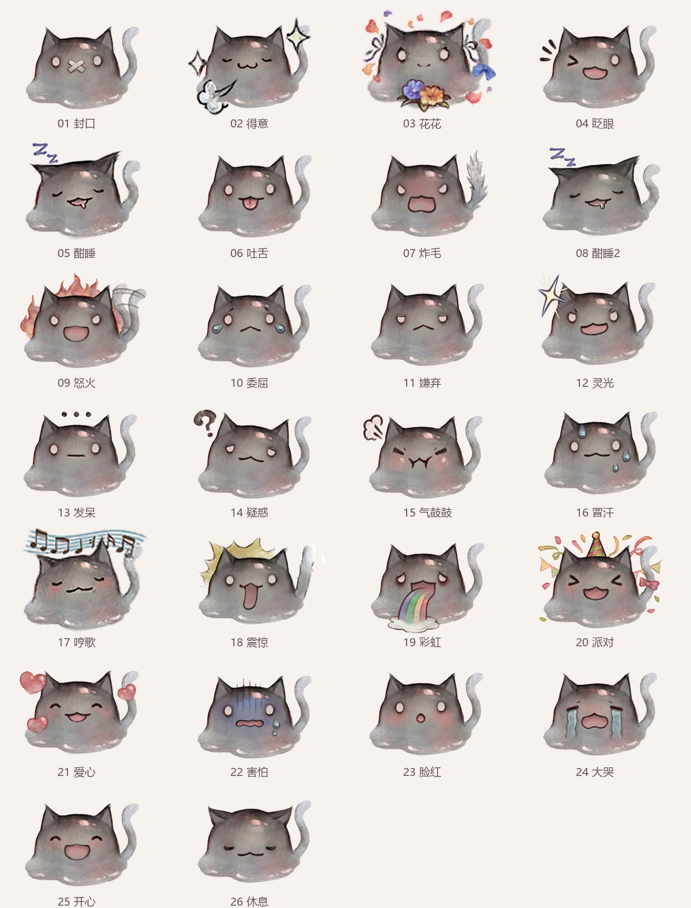

# 猫溶溶桌宠

以毛绒果冻猫“猫溶溶”为形象的 Windows 离线互动桌宠。保留原图轮廓、配色和毛绒质感，支持 26 种表情、独立特效、尾巴动作和身体伸缩。

首个发布版本为 **1.0**，后续优化继续在本仓库更新。



## 下载与运行

在本仓库的 **Releases** 页面下载 `猫溶溶-Windows便携版.zip`。解压后双击 `猫溶溶.exe`，保留旁边的 `_internal` 文件夹。无需安装 Python。

`猫溶溶-PNG与GIF.zip` 提供透明 PNG 和分享用 GIF。GitHub 自动生成的 Source code 压缩包包含项目源码和素材，不包含 Windows 程序。

## 功能

- 单击互动、拖动、大小调整、右键菜单和托盘小屋。
- 常态随机表情、眨眼、缓慢游走、随系统音频哼歌。
- 委屈与疑惑两条无人互动情绪链，按亲密值选择点击动作。
- 亲密、饱腹和精力属性；摸摸、喂食、玩耍、睡眠。
- 情绪盒子、全满派对、花花双速游走、闭嘴锁定。
- 约 5 秒短动作；酣睡 30 秒后进入酣睡2；退出时融化消失。

详细操作见 [使用说明](使用说明.md)，时长、概率及属性变化见 [行为规则](行为规则.md)。

## 从源码运行

推荐 Windows 10/11、Python 3.12：

```powershell
python -m pip install -r requirements.txt
python app.py
```

仓库包含可直接播放的无损透明 WebP、原始参考和高清素材。完整生成素材：

```powershell
python scripts/regenerate.py
```

常规生成使用已保存的 `assets/restored` 清晰化缓存。`prepare_superresolution.py` 是可选的缓存准备工具，需要额外的 OpenCV contrib 超分辨率模块和 EDSR 模型，不属于日常运行依赖。

## 测试与构建

```powershell
python test_companion_rules.py
python scripts/test_companion_ui.py
python scripts/test_click_cycle.py
python scripts/test_sleep_progression.py
python scripts/test_transition_opacity.py
python scripts/build.py
python scripts/package.py
```

`scripts/verify.py` 检查分享 GIF 时长等素材内容，执行前先运行素材生成以补全内部 GIF 副本。构建结果在 `dist/猫溶溶`。整合包通过 Release 分发，本地构建目录、诊断截图和缓存不进入 Git 历史。

## 素材说明

原角色及原始表情素材权利归原权利人所有。此仓库的发布不改变原素材权属，也不额外授予原素材的商业使用许可。

对 100×100 小图采用保留像素布局的清晰化，细节仍受原始分辨率限制。完整透明动画使用 WebP，GIF 另行导出用于分享。
